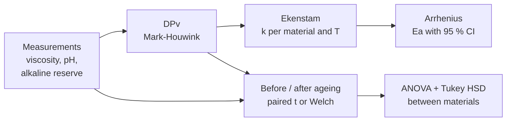
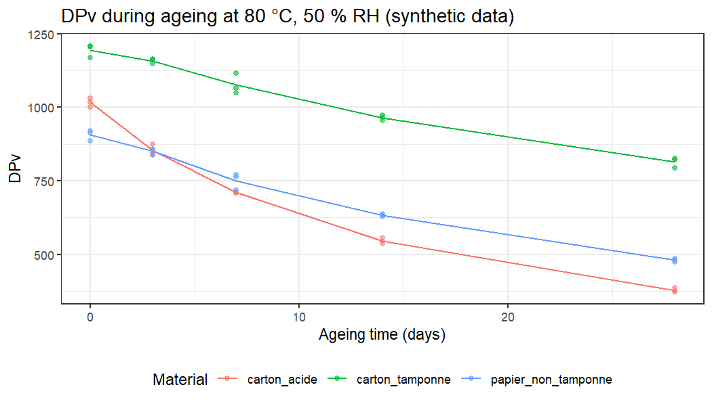
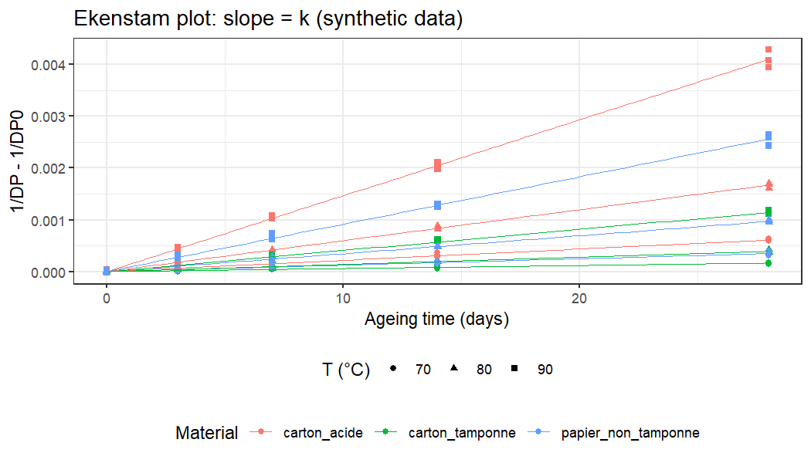
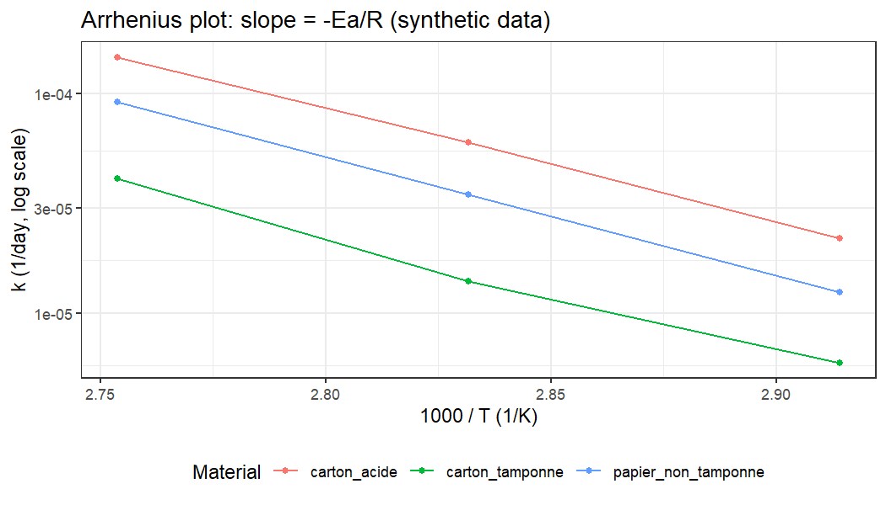
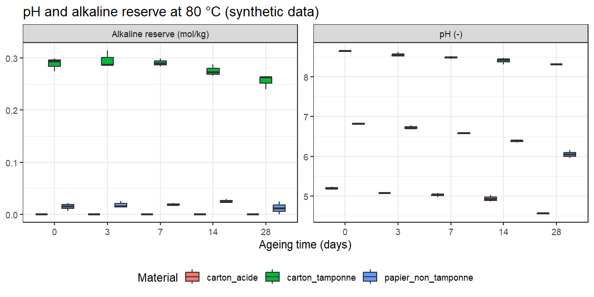

# cellulose-ageing-r

 -brightgreen) 

R pipeline that turns accelerated-ageing measurements of paper and board (intrinsic viscosity, pH, alkaline reserve) into degradation kinetics and an activation energy, with before/after statistics between materials.

> **The example data are synthetic.** `data/exemple_vieillissement.csv` is generated by `data-raw/make_synthetic.py` from the very model the code fits (Ekenstam + Arrhenius + noise). They are not measurements and prove nothing about any real material; they only exercise the pipeline.

**What this shows**

- Cellulose degradation chemistry applied correctly: viscometric DP (Mark-Houwink, ISO 5351), Ekenstam kinetics, chain scissions, Arrhenius activation energy.
- Statistics with uncertainty: 95 % confidence intervals on k and Ea, paired t / Welch, ANOVA + Tukey HSD.
- Verifiable code: unit tests on hand-computed values and noise-free recovery of known parameters.
- Honest about limits: see [Limits](#limits), including a wide Ea interval when only 3 temperatures are used.

## Pipeline



## Results on the synthetic data


*DPv at 80 C: the buffered board loses DP more slowly than the acidic board and the unbuffered paper.*


*Ekenstam linearisation 1/DP - 1/DP0 against time; the slope of each line is k.*


*ln k against 1/T for the three materials; the slope gives Ea (about 99-103 kJ/mol here, close to the 95-105 used by the generator).*


*pH and alkaline reserve at 80 C: only the buffered board has a measurable reserve, which is consumed during ageing.*

## Method

- **Accelerated ageing**: temperature/humidity series as in ISO 20404 (conditions in the
  example: 70, 80, 90 C at 50 % RH; check them against the standard you apply).
- **DPv**: intrinsic viscosity in cupriethylenediamine (ISO 5351) converted with the
  Mark-Houwink relation `DP^0.905 = 0.75 [eta]` ([eta] in mL/g; constants after Henniges
  et al., Cellulose 2011, to be checked against your edition of ISO 5351; K and a are
  arguments of `dpv_from_viscosity()`).
- **Kinetics**: Ekenstam, `1/DP(t) - 1/DP0 = k t`, regression through the origin with 95 % CI;
  chain scissions per initial chain `DP0/DP - 1`; Arrhenius `ln k = ln A - Ea/RT` (needs
  at least 3 temperatures).
- **Comparison**: per material, before vs after ageing (paired t-test, Welch if sizes
  differ) for DPv, pH and alkaline reserve; one-way ANOVA + Tukey HSD on the change between
  materials.

## Run

Requires R (tested with 4.6.2) with `ggplot2` and `testthat`.

```sh
Rscript analyse.R                  # tables in outputs/ (git-ignored), figures in docs/img/ (these are the README images)
Rscript tests/testthat.R           # unit tests
```

## Limits

- Synthetic data only; no real measurement has been processed.
- The Ea confidence interval of the buffered board is very wide ([-2.9, 203] kJ/mol): with 3 temperatures the Arrhenius regression has 1 degree of freedom (t = 12.7), and the k at 70 C is noisy. It is a property of the design, not a bug; more temperatures are needed for a usable interval.
- Alkaline reserve of the acidic board is constant (0), so its before/after test returns NaN.
- Pairing before/after is by replicate order, which assumes the same sample is measured
  twice; with destructive viscometry this is a simplification (use Welch otherwise).
- Arrhenius extrapolation to storage conditions is not provided: it is sensitive to the
  mechanism change between ageing and storage temperatures.
- Tested locally under R 4.6.2 (12 unit tests pass, analysis runs end to end); no CI is configured.
